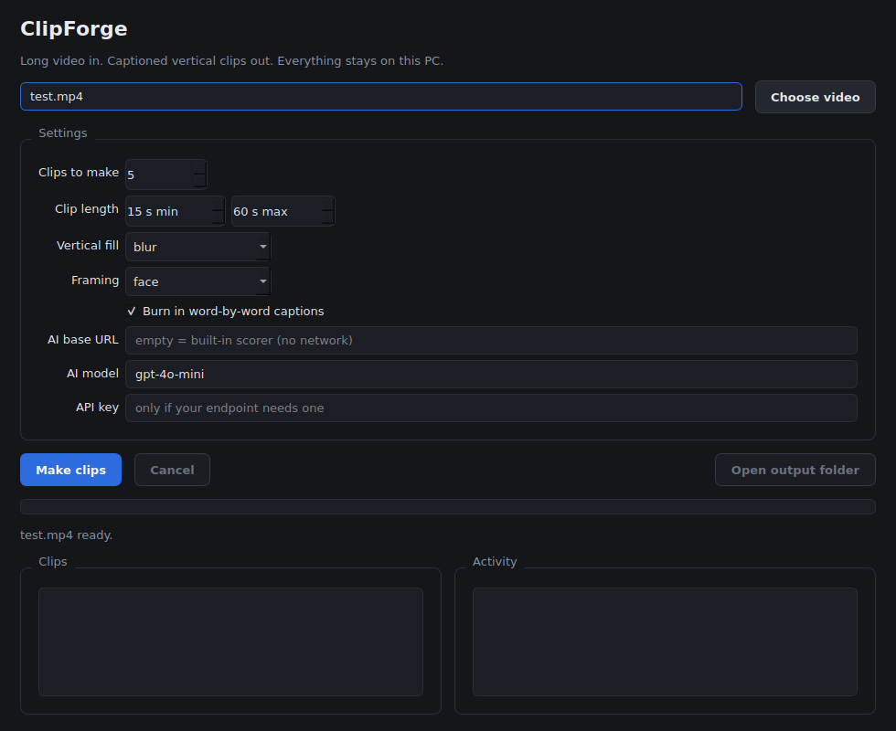

# ClipForge

Turn one long video into a handful of captioned, vertical clips — on your own PC.

Drop in a podcast, interview, webinar or YouTube download. ClipForge transcribes it,
finds the moments that actually work as standalone short-form video, reframes them
to 9:16, burns in word-by-word captions, and writes the files out. No upload, no
subscription, no watermark.



```
video ─▶ audio ─▶ transcript ─▶ pick moments ─▶ vertical reframe ─▶ captions ─▶ clips/
```

---

## What it actually does

| Step | What happens | Built with |
| --- | --- | --- |
| **Transcribe** | Speech to text with timestamps | `faster-whisper` locally, or any Whisper API, or your own `.srt` |
| **Pick moments** | Scores every candidate window for hook strength, payoff, energy, completeness and length; removes overlapping picks | Built-in scorer, or an LLM for editorial judgement |
| **Reframe** | Fills 1080×1920 with blurred sides, a smart crop, or letterbox. Optional face tracking keeps the speaker centred | ffmpeg (+ OpenCV when installed) |
| **Caption** | Big word-by-word captions, active word highlighted, safely above the TikTok/Reels UI | ffmpeg `libass` |
| **Export** | H.264 + AAC MP4, `+faststart`, plus thumbnails and a manifest | ffmpeg |

Everything runs locally. The only optional network calls are the Whisper API and the
LLM highlight picker, and both are off unless you configure them.

---

## Requirements

- **Python 3.10+**
- **ffmpeg** with libass (the normal Windows build has it)
- Windows 10/11, macOS, or Linux

Optional extras:

- `faster-whisper` — free offline transcription (recommended)
- `PySide6` — the desktop app
- `opencv-python-headless` — face-aware reframing

---

## Windows quick start

**1. Install Python.** <https://www.python.org/downloads/> — tick **“Add python.exe to PATH”**.

**2. Install ffmpeg.** Open PowerShell and run:

```powershell
winget install Gyan.FFmpeg
```

Then close and reopen the terminal so `ffmpeg` is on your PATH.

**3. Set up ClipForge.** Double-click **`setup.bat`**. It creates `.venv`, installs
everything, and prints a health check.

**4. Run it.** Double-click **`run.bat`**. Choose a video, hit **Make clips**.

For the command line, use **`clipforge.bat`**:

```bat
clipforge.bat run "C:\Videos\podcast.mp4"
```

> First transcription downloads a Whisper model (about 500 MB for `small`) into your
> user cache. That is a one-time download.

> If `faster-whisper` refuses to install on a very new Python version, use Python
> 3.11 or 3.12, or switch to the cloud API with `OPENAI_API_KEY`. Everything else
> still works without it.

---

## Command line

```bash
# Default: 5 clips, 15-60s, blurred vertical fill, captions on
clipforge run podcast.mp4

# More clips, tighter pacing, crop instead of blur
clipforge run talk.mp4 -n 8 --min-duration 20 --max-duration 45 --layout crop

# Reuse a transcript you already have (no Whisper, no API)
clipforge run talk.mp4 --transcript subtitles.srt

# Just show the picks, render nothing
clipforge analyze talk.mp4

# Check your install
clipforge check
```

Common flags:

| Flag | Meaning |
| --- | --- |
| `-n, --count` | how many clips to produce |
| `--min-duration` / `--max-duration` | clip length window in seconds |
| `--layout blur\|crop\|pad` | how the 9:16 frame is filled |
| `--reframe face\|center` | face-tracked crop or a fixed centre crop |
| `--no-captions` | skip burned-in subtitles |
| `-o, --out` | output folder |
| `--transcript FILE` | reuse a `.srt`, `.vtt` or `.json` transcript |
| `--whisper-model` | `tiny`, `base`, `small`, `medium`, `large-v3` |
| `--llm-base` / `--llm-model` / `--llm-key` | highlight picker endpoint |
| `--no-llm` | force the built-in scorer |
| `--dry-run` | print the ffmpeg work without rendering |
| `-v` | show ffmpeg output |

---

## Choosing the highlight picker

### Built-in scorer (default, no network)

Scores rolling windows of the transcript on:

- **Hook** — questions, numbers, “never/worst/secret/how to”, direct address
- **Payoff** — “because”, “turns out”, “the reason”, “here’s the thing”
- **Energy** — words per second, exclamation, emotional vocabulary
- **Completeness** — starts and ends on sentence boundaries
- **Penalties** — filler words, slow speech, intros and outros, odd lengths

It is fast, free and surprisingly decent. It is not an editor, though.

### LLM mode (better taste)

Any OpenAI-compatible endpoint works:

```bash
# OpenAI
clipforge run video.mp4 --llm-base https://api.openai.com/v1 \
  --llm-model gpt-4o-mini --llm-key sk-...

# Groq (fast and cheap)
clipforge run video.mp4 --llm-base https://api.groq.com/openai/v1 \
  --llm-model llama-3.3-70b-versatile --llm-key gsk_...

# DeepSeek
clipforge run video.mp4 --llm-base https://api.deepseek.com/v1 \
  --llm-model deepseek-chat --llm-key sk-...

# Ollama, fully local
clipforge run video.mp4 --llm-base http://localhost:11434/v1 --llm-model llama3.1

# LM Studio
clipforge run video.mp4 --llm-base http://localhost:1234/v1 --llm-model local-model
```

Save it once instead of typing it every time:

```bash
clipforge config --set llm_base_url=https://api.openai.com/v1 llm_model=gpt-4o-mini
clipforge config --set llm_api_key=sk-...
```

If the model returns nothing usable — or the endpoint is down — ClipForge falls back
to the built-in scorer rather than failing the run.

---

## Transcription options

**Local (recommended).** `pip install faster-whisper` and you are done. Model sizes:

| Model | Speed on CPU | Quality |
| --- | --- | --- |
| `tiny` | very fast | rough, good for testing |
| `base` | fast | okay for clear speech |
| `small` | moderate | **good default** |
| `medium` | slow | better on accents and noise |
| `large-v3` | very slow on CPU | best; use a GPU |

With an NVIDIA GPU, faster-whisper uses CUDA automatically and is dramatically
faster. Force CPU with `clipforge config --set whisper_device=cpu`.

**Cloud.** Set `OPENAI_API_KEY` (or `CLIPFORGE_STT_BASE` + `CLIPFORGE_STT_KEY`) and
run with `--stt api`. Groq is a good cheap option for long files.

**Bring your own.** `--transcript subs.srt` skips transcription entirely.

---

## Captions and framing

- **Layouts** — `blur` (safest, default), `crop` (best for talking heads), `pad`.
- **Face tracking** — with `opencv-python-headless` installed and `--layout crop`,
  ClipForge samples the clip at 4 fps, finds the largest face, smooths the path and
  animates the crop to follow it. Without OpenCV it centres the crop.
- **Caption style** — tune the defaults with `clipforge config --set`:

```bash
clipforge config --set font_size=84 caption_max_words=3 highlight_color=FFD400
```

---

## Output

```
Videos/ClipForge/my-video-20261115-143000/
├── 01-the-two-hour-rule.mp4
├── 01-thumb.jpg
├── 02-protect-the-block.mp4
├── 02-thumb.jpg
├── clips.json          # what was picked, scores, reasons, settings
├── transcript.srt      # reuse with --transcript on a re-run
└── transcript.json
```

`clips.json` is the audit trail: every clip’s start, end, score, title and reason.

---

## Troubleshooting

**“ffmpeg was not found.”**
Install it and reopen your terminal: `winget install Gyan.FFmpeg`. Verify with `ffmpeg -version`.
If it is installed somewhere unusual, set `FFMPEG_BIN` and `FFPROBE_BIN` to the full paths.

**“libass MISSING — ffmpeg build has no subtitles filter.”**
Your ffmpeg build lacks `libass`. Use a full build (Gyan.FFmpeg on Windows) or run
with `--no-captions`.

**Captions look wrong or missing.**
Run `clipforge analyze video.mp4 --transcript subs.srt` first to confirm the transcript
covers the right time range. Captions are only drawn where words exist.

**Everything is slow.**
Transcription dominates. Try `--whisper-model base`, or a GPU. Rendering runs at
roughly 0.5–1× clip length on a modern CPU.

**A very long video.**
Transcripts over ~120k characters get truncated for the LLM prompt (set
`CLIPFORGE_MAX_TRANSCRIPT_CHARS` to change that). Split multi-hour files, or use a
model with a large context window.

**The model replies with nonsense.**
Some servers ignore `response_format: json_object`. ClipForge retries without it and
parses the JSON out of the reply, but a stronger model gives better picks. `--no-llm`
always works.

---

## Project layout

```
clipforge/
├── clipforge/
│   ├── cli.py          # argument parsing and commands
│   ├── pipeline.py     # the end-to-end job
│   ├── media.py        # ffprobe / audio extraction
│   ├── transcribe.py    # faster-whisper and API backends
│   ├── transcript.py   # SRT/VTT/JSON parsing, word timing
│   ├── analyze.py      # LLM and heuristic highlight picking
│   ├── prompts.py      # the editor prompt
│   ├── captions.py     # ASS generation
│   ├── render.py       # ffmpeg filter graphs
│   ├── track.py        # optional face tracking
│   ├── gui.py          # PySide6 desktop app
│   └── util.py         # paths, processes, HTTP
├── tests/
├── setup.bat           # Windows one-click install
├── run.bat             # Windows GUI launcher
└── clipforge.bat       # Windows CLI launcher
```

Run the tests:

```bash
python -m unittest discover -s tests
```

---

## Ideas for v2

- Silence and scene-cut detection to align clip edges to visual beats
- Multi-speaker split-screen with active-speaker detection
- Burned-in title cards from the `title` field
- Translation and dual-language captions
- Auto B-roll and zoom punches
- One-file `.exe` via PyInstaller
- A clip editor timeline in the GUI before export

---

MIT licensed. Built to run on your machine, not someone else’s server.
